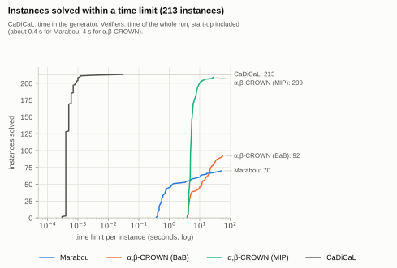
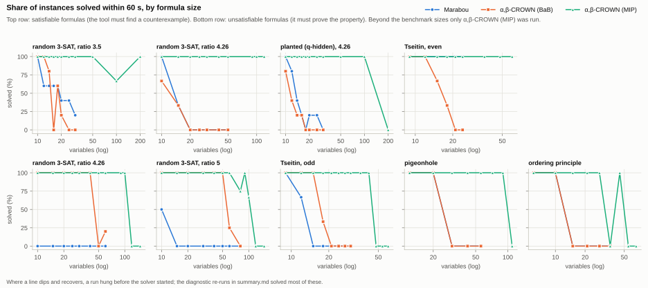
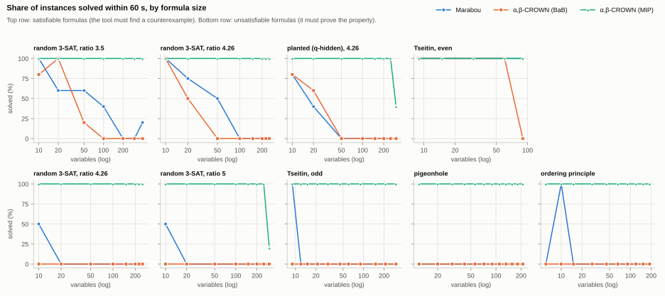

# relu-sat-bench

[](https://github.com/adrianwurm/relu-sat-bench/actions/workflows/tests.yml)
[](https://doi.org/10.5281/zenodo.24417857)

**Provably hard neural network verification instances with known answers, generated from SAT.**

Every instance consists of a ReLU network `N`, the input box `[0, 1]^n` and the property
"`N(x) < m - 1/2` for all `x` in the box". The network is built from a CNF formula with
`n` variables and `m` clauses so that the property is **violated if and only if the formula
is satisfiable**. The correct answer of every instance is therefore known (a SAT solver
decides it), and the difficulty of the instance is inherited from the formula.

> Version 1.0.0: generator, export, verifier runs and evaluation are complete.

- [x] Reduction SAT → ReLU verification, with exact-arithmetic tests
- [x] Instance generator (random 3-SAT around the phase transition, structured formulas) with checked answers
- [x] Export to ONNX + VNN-LIB (VNN-COMP format), every network checked with onnxruntime
- [x] Runs with α,β-CROWN and Marabou in Docker: pilot, frozen benchmark set, final runs, scaling experiment
- [x] Evaluation: solved instances, run times, wrong answers, other encodings, a ten times longer timeout
  (see [Results](#results))
- [x] Release: all result files in [`results/`](results/), tests on every push, citable releases

## The construction

The reduction is based on the proof of Theorem 2 ii) in Wurm, CPAIOR 2024 (see
[References](#references)). Two encodings of it are implemented; they compute the same function on
the input box. A third encoding, from a related benchmark, is there for comparison.

**compact** (default, used for the experiments): `2n + m` ReLUs in two hidden layers.

| layer | width | computes |
|---|---|---|
| 1 | `2n` | literal nodes `pos_i = ReLU(2x_i - 1)`, `neg_i = ReLU(1 - 2x_i)` |
| 2 | `m` | `u_j = ReLU(1 - s_j)`, where `s_j` is the sum of the literal nodes of clause `j` |
| 3 | `1` | `N(x) = m - (u_1 + ... + u_m)` |

**paper**: the construction exactly as written in the paper. It has `7n + 3m` ReLUs in six
hidden layers: it clamps the inputs with `Psi(t) = ReLU(t) - ReLU(t - 1)`, builds the same
literal nodes, and sums the clause values `Psi(s_j)`. It is kept for reference and for
comparing how the encoding affects the tools.

At most one of `pos_i`, `neg_i` is non-zero, so every input induces a partial assignment.
The clause value `min(s_j, 1) = 1 - u_j` is positive exactly when that partial assignment
satisfies clause `j`. Consequently the maximum of `N` over the box equals the MaxSAT value of
the formula: it is `m` if the formula is satisfiable and at most `m - 1` otherwise. The
threshold `m - 1/2` lies in the middle of this gap. All weights and biases are integers.
Details and the full argument are in the docstring of
[`reduction.py`](src/relu_sat_bench/reduction.py).

**neurocodebench**: the construction of the VNN-COMP 2025 benchmark `sat_relu` (see
[Related benchmarks](#related-benchmarks)), rebuilt to compare encodings on the same formulas. It has
`m + 2n` ReLUs in one hidden layer and two outputs: `Y_0 = 1 - (number of falsified clauses)` at 0/1
points, and `Y_1 = sum_i min(x_i, 1 - x_i)`, which is 0 exactly at the 0/1 points. The unsafe set
`Y_0 >= 1 and Y_1 <= 0` is reachable iff the formula is satisfiable, but without a margin: every
counterexample must be an exact 0/1 point.

## Quickstart

```bash
python -m venv .venv
source .venv/bin/activate          # Windows: .venv\Scripts\activate
pip install -e ".[dev]"
pytest
```

```python
from relu_sat_bench import CNF, reduce_cnf

cnf = CNF.from_clauses([[1, -2, 3], [-1, 2, -3]])   # DIMACS-style literals
instance = reduce_cnf(cnf)                           # encoding="compact" by default

instance.network.forward([1, 0, 0])        # array([2.]): both clauses satisfied
instance.network.forward([0.5, 0.5, 0.5])  # array([0.]): no literal is true
instance.threshold                         # Fraction(3, 2)
instance.is_counterexample([1, 0, 0])      # True, so the formula is satisfiable

reduce_cnf(cnf, encoding="paper")          # the 7-layer network from the paper
```

Dependencies: NumPy, `python-sat`, `onnx`, `onnxruntime`.

## Generating formulas

```bash
python -m relu_sat_bench.generate --out instances/demo random --vars 20 50 --ratio 3.5 4.26 5 --count 20
python -m relu_sat_bench.generate --out instances/demo pigeonhole --holes 4 5 6
```

| family | answer known from | why it is interesting |
|---|---|---|
| `random` | SAT solver (CaDiCaL), "unsat" confirmed by a second solver | phase transition at about 4.26 clauses per variable |
| `planted` | construction (satisfiable, hidden solution) | satisfiable instances at any density; `q-hidden` hides the solution from literal statistics |
| `pigeonhole` | construction (unsatisfiable) | exponentially hard for resolution, hence for CDCL solvers |
| `tseitin` | construction (odd: unsatisfiable, even: satisfiable) | parity constraints on random 3-regular graphs, hard for resolution |
| `ordering` | construction (unsatisfiable) | easy for CDCL, hard for tree-like resolution (DPLL) |

Every run writes `cnf/<id>.cnf` (DIMACS), `solutions/<id>.sol` for satisfiable formulas, and
`formulas.csv` with the reference answer, how it was checked, and the SAT solver's runtime. Every
instance is reproducible from its seed.

## Building the benchmark

```bash
python generate_properties.py <seed> [output folder]     # VNN-COMP convention, default folder: benchmark/
python generate_properties.py <seed> [output folder] --neurocodebench         # the second set, see below
python generate_properties.py <seed> [output folder] --threshold-in-network   # variant, see below
python generate_properties.py <seed> [output folder] --scaling                # larger formulas, see below
python generate_properties.py <seed> [output folder] --sample --neurocodebench  # comparison, see below
```

This runs the generator lines listed in `SPEC` at the top of `generate_properties.py` (213 instances,
3.6 h of timeouts at 60 s each) and exports every formula with a known answer:

| file | content |
|---|---|
| `instances.csv` | VNN-COMP instance list: `onnx,vnnlib,timeout` per line |
| `onnx/f0001.onnx`, ... | the network: `Gemm`/`Relu` layers, float32, input `X` [1, n], output `Y` [1, 1] |
| `vnnlib/f0001.vnnlib`, ... | the property: input box `[0, 1]^n`, unsafe set `Y_0 >= m - 1/2` |
| `metadata.csv` | maps files to formulas; expected answer (`sat` = counterexample exists), sizes, threshold, right-hand side in the VNN-LIB file, SAT-solver time |
| `formulas.csv`, `cnf/`, `solutions/` | the formulas, reference answers and known solutions |

The expected answers appear only in `metadata.csv`, never in the files the tools read. File names
are neutral numbers in a seeded random order, because a family name such as `pigeonhole` would
reveal the answer. Every ONNX file is
run in onnxruntime right after export and compared with the exact network: on 0/1 points the output
must equal the number of satisfied clauses exactly. The same seed gives byte-identical files.
`python -m relu_sat_bench.export --dir <folder> --encoding compact paper` exports formulas generated by
hand; `paper` adds the 7-layer network from the paper.

**How the sizes were chosen.** A pilot run with 77 instances (`--pilot`, seed 0) showed where Marabou and
α,β-CROWN stop solving each family. The size ladders in `SPEC` were set once from it, so that every family
ranges from "every tool solves it" to "no tool solves it", and then frozen. Satisfiable and unsatisfiable
formulas get separate ladders, because α,β-CROWN refutes much larger formulas than it can find
counterexamples for. Instances are never selected individually by tool results, and the evaluation uses a
different seed than the pilot.

**The second set (`--neurocodebench`)** has 209 instances in the `sat_relu` encoding (3.5 h of timeouts),
frozen in `NCB_SPEC`. In that encoding Marabou and branch-and-bound fail on very small formulas, while MIP
gets to 250-300 variables and solves pigeonhole, Tseitin and ordering formulas far beyond CaDiCaL (see
[Same formulas, other encodings](#same-formulas-other-encodings)), so every ladder starts at 10 variables and
ends beyond MIP's limit: random formulas up to 250-400 variables, planted up to 300, pigeonhole up to 14 holes,
Tseitin up to 300 variables, ordering up to n = 20. Ten of its formulas are beyond CaDiCaL within 60 s
(pigeonhole h11-h14, Tseitin from 150 variables); their answers come from the construction. With seed 1, its
73 formulas of sizes that also occur in `SPEC` are identical to those of the first set.

**`--scaling`** builds 65 larger formulas (random up to 200 variables, pigeonhole h8–h10, ordering n9–n12,
Tseitin up to 60 variables) for a separate scaling experiment. It is not part of the benchmark set: MIP
(Gurobi through α,β-CROWN) solved nearly all frozen instances, and these formulas continue the ladders until
it fails too.

**`--threshold-in-network`** writes an equivalent variant: the last bias of each network is lowered by
`m - 1/2`, and the unsafe set becomes `Y_0 >= 0`. With the same seed it contains the same formulas under the
same file names. It exists because α,β-CROWN's MIP mode currently compares single-constraint properties
with 0 instead of their right-hand side (as of commit `b58d83c`); on the normal files it reports
"unsafe" and then crashes.

**Comparing encodings.** `--sample` builds one formula per size of the frozen set (the 57 formulas with index
000, identical to those in the full set with the same seed), and `--neurocodebench` encodes them in the
`sat_relu` construction instead (`onnx/f0001-neurocodebench.onnx`, output `Y` [1, 2], and its own
`vnnlib/f0001-neurocodebench.vnnlib`). The other direction reads the formulas back out of the published
`sat_relu` networks and encodes them in any of the three encodings:

```bash
python -m relu_sat_bench.satrelu --source <downloaded sat_relu folder> --out instances/satrelu-compact
python -m relu_sat_bench.satrelu --source <...> --out instances/satrelu-compact-shifted --threshold-in-network
python -m relu_sat_bench.satrelu --source <...> --out instances/satrelu-ncb --encoding neurocodebench
```

The import checks every network's structure, checks that our `neurocodebench` network computes the same
function as the published one, and decides each formula with CaDiCaL (unsatisfiable answers confirmed by a
second solver); the answer must match the `sat`/`unsat` label of the file name. The `sat_relu` files are not
included here (their repository states no license); download `benchmarks/sat_relu` from
`VNN-COMP/vnncomp2025_benchmarks`. `python -m relu_sat_bench.evaluate --compare <folders> --name <name>`
writes `report/encodings-<name>.md`: per tool and encoding the verdicts on the same formulas.

## Running the verifiers

Each tool runs in its own Docker image together with this package. The runner starts the tool once per
instance with the VNN-COMP calling convention (`<tool> ONNX VNNLIB RESULT TIMEOUT`), kills it at the
time limit, and checks every answer: the expected result from `metadata.csv`, and every counterexample
independently (input box, exact network output above the threshold, and a satisfying assignment after
rounding).

```bash
docker build -f docker/marabou/Dockerfile -t relu-sat-bench/marabou .
docker run --rm --cpus 4 -v "$PWD/benchmark:/bench" relu-sat-bench/marabou --bench /bench --tool marabou

docker build -f docker/abcrown/Dockerfile -t relu-sat-bench/abcrown .
docker run --rm --cpus 4 -v "$PWD/benchmark:/bench" relu-sat-bench/abcrown --bench /bench --tool abcrown-bab
docker run --rm --cpus 4 -v "$PWD/benchmark-shifted:/bench" relu-sat-bench/abcrown --bench /bench --tool abcrown-mip
```

Results go to `benchmark/results/<tool>.csv`, one row per instance, with a verdict of `correct`, `wrong`,
`sat-no-cex`, `timeout`, `no-answer` or `error`. Runs can be interrupted and resumed. `--retry-errors`
repeats crashed runs, `--rerun --only f0042 ...` repeats single instances, and `--retry-suspended` repeats
runs during which the computer slept (detected by comparing the monotonic clock with the wall clock;
tools that check their time limit with the wall clock give up early after a sleep). α,β-CROWN uses the
configuration its authors chose for the VNN-COMP 2025 benchmark `sat_relu`, either unchanged
(`abcrown-mip`, MIP with Gurobi, on the `--threshold-in-network` variant) or with its default
branch-and-bound (`abcrown-bab`). Gurobi's free pip license is limited to small models; the larger
instances need a (free academic) license file.

## Results

213 instances, 60 s per instance, 4 CPU cores per tool. Full tables: [`report/summary.md`](report/summary.md);
the result files of all runs are in [`results/`](results/).

| | solved | wrong | satisfiable solved | unsatisfiable solved |
|---|---|---|---|---|
| CaDiCaL (SAT solver, on the formulas) | 213, each in at most 0.03 s | – | 128 | 85 |
| α,β-CROWN, MIP mode (Gurobi) | 209 | 0 | 126 | 83 |
| α,β-CROWN, branch-and-bound | 92 | 0 | 40 | 52 |
| Marabou | 70 | 0 | 60 | 10 |





- **No tool gave a wrong answer** on this set. Every counterexample was checked independently. (Marabou did on
  formulas of the `sat_relu` benchmark, see [Same formulas, other encodings](#same-formulas-other-encodings).)
- **Every verifier fails on networks with fewer than 1,000 nonzero parameters, built from formulas a SAT solver
  handles in milliseconds.** The smallest networks at which a tool fails (it solves less than half from that size
  on, 60 s each) have 256 nonzero parameters for Marabou, 303 for branch-and-bound and 833 for MIP (Tseitin
  formulas with 48 variables); table "Network size at each tool's limit" in [`report/summary.md`](report/summary.md).
  The scaling experiment continues
  the ladders for the strongest tool, α,β-CROWN's MIP mode, which hands the problem to Gurobi. It finds its
  limit at about 100 variables for unsatisfiable random 3-SAT, about 45 for Tseitin formulas and n = 10 for the
  ordering principle. CaDiCaL needs at most 0.04 s for the formulas at these limits. Pigeonhole formulas are the
  exception: they are hard for CDCL as well (59 s at 10 holes), and Gurobi fails at the same size. In the
  `sat_relu` encoding the same MIP mode gets much further and fails only where CaDiCaL needs seconds (see
  [Same formulas, other encodings](#same-formulas-other-encodings)); Marabou and branch-and-bound fail early in
  every encoding.
- **The hard networks are small.** At the size where a tool first solves less than half of a family, the
  networks have 10–200 inputs and encode 40–850 clauses. Stored as ONNX files they have 1.2k–420k parameters,
  but almost all of these are zeros: each literal neuron reads one input and each clause neuron only its
  literals, so only 260–5,100 parameters are nonzero (all of them small integers). Table "Network size at each
  tool's limit" in [`report/summary.md`](report/summary.md). Typical verification benchmarks are of the same
  size or far larger, and in trained networks practically every parameter is nonzero:

  | network | inputs | clauses | nonzero parameters | parameters as stored |
  |---|---|---|---|---|
  | relu-sat-bench, where Marabou fails | 10–30 | 40–81 | 260–460 | 1.2k–6.9k |
  | relu-sat-bench, where α,β-CROWN (BaB) fails | 12–60 | 46–300 | 300–1.7k | 1.6k–44k |
  | relu-sat-bench, where α,β-CROWN (MIP) fails | 48–200 | 128–852 | 830–5.1k | 17k–420k |
  | ACAS Xu (VNN-COMP) | 5 | – | – | 13k |
  | `sat_relu` (VNN-COMP 2025), all 100 solved by α,β-CROWN | 6–100 | 9–485 | 94–26k | 326–70k |
  | CIFAR-100 ResNets (VNN-COMP 2025) | 3072 | – | – | 2.5M–3.8M |

  Sizes of ACAS Xu and the CIFAR-100 networks: Table 3 of the VNN-COMP 2025 report (Kaulen et al.,
  arXiv:2512.19007). `sat_relu`: measured on the 98 published networks (the report gives 2–100 inputs and
  100–35k parameters).
  At VNN-COMP 2025, the smallest network with an instance no tool solved had 55k nonzero parameters
  (relusplitter; regular track: 575k, CORA), counted in the published networks
  ([`report/vnncomp2025.md`](report/vnncomp2025.md); the hardware and time limits there differ from ours).
  What makes our networks hard is not their size: on the input box every ReLU is unstable, that is, depending
  on the input it is active or inactive, and the verifier has to reason about all of these switches at once.
  In local-robustness properties around a given input, the small input region usually fixes most ReLUs to one
  phase. How hard a network of this size is depends on the formula and, as the next section shows, just as much
  on the encoding.
- **Proving and finding are different problems.** α,β-CROWN's branch-and-bound refutes unsatisfiable random
  formulas up to 60 variables, but finds counterexamples only with the gradient attack that runs before it
  (up to 20 variables). In this configuration branch-and-bound never reads off a counterexample, not even
  in regions where every ReLU is fixed. Marabou is the other way round: better at finding than at proving.
- **Ten times more time moves the limits for proofs, hardly for finding.** Rerun with 600 s instead of 60 s at
  each tool's first failing sizes ([`report/long-timeout.md`](report/long-timeout.md)), branch-and-bound proves
  19 of 21 unsatisfiable instances (first two failing sizes) and MIP 14 of 18, so for proofs both get at least two
  size steps further, e.g. random unsatisfiable formulas from 60 to 80 (branch-and-bound) and from 120 to 150
  variables (MIP). For proofs the limits above are limits of the 60 s timeout. Marabou proves none of its 10 and
  finds 3 of 10 counterexamples at its first failing size; branch-and-bound finds none, because it gives up after
  50-103 s ("all nodes are split"), long before the timeout.
- **Two problems in α,β-CROWN came up.** Its MIP mode compares single-constraint properties with 0 instead of
  their right-hand side (reported as [issue #111](https://github.com/Verified-Intelligence/alpha-beta-CROWN/issues/111);
  the `--threshold-in-network` variant works around it), and about 1 run in 25 in MIP mode
  hung before Gurobi started (repeated runs solved most of them; the tables count the first run).

Reproduce the tables and figures from the result files in [`results/`](results/) (the commands for every
other report are in [`results/README.md`](results/README.md); a test checks that all tables match):

```bash
pip install -e ".[report]"          # matplotlib, for the figures
python -m relu_sat_bench.evaluate --bench results/final results/final-shifted \
    --extension results/scaling-shifted --out report
```

### Same formulas, other encodings

The 98 formulas of the VNN-COMP 2025 benchmark `sat_relu`, read back from its networks, and one formula per size
of our set (57), each in several encodings (see [Comparing encodings](#building-the-benchmark)). Correct answers,
wrong answers in brackets; full tables in [`report/encodings-satrelu.md`](report/encodings-satrelu.md) and
[`report/encodings-sample.md`](report/encodings-sample.md):

| formulas | tool | compact | paper | neurocodebench |
|---|---|---|---|---|
| 98 `sat_relu` (49 sat, 49 unsat) | Marabou | 52 (1) | 51 (12) | 49 (10) |
| | α,β-CROWN, branch-and-bound | 52 | 52 | 49 |
| | α,β-CROWN, MIP | 71 | 70 | 98 |
| 57 of ours (29 sat, 28 unsat) | Marabou | 22 | – | 24 |
| | α,β-CROWN, branch-and-bound | 22 | – | 19 |
| | α,β-CROWN, MIP | 55 | – | 57 |

- **The encoding matters as much as the formula, in opposite directions.** For MIP the `sat_relu` encoding is
  by far the easiest: Gurobi needs at most 0.7 s for any of the 155 formulas, while in compact 27 unsatisfiable
  `sat_relu` formulas time out. For Marabou and branch-and-bound it is the hardest one for proofs: of the 77
  unsatisfiable formulas they prove 2 and 0 (in compact, branch-and-bound proves 15 of our 28).
- **For MIP, it is mostly the network.** α,β-CROWN adds a property with two constraints to the MIP
  ("AND-style") and handles a single constraint by maximizing the output ("OR-style"). Writing the compact
  property as two constraints (`m - 1/2 <= Y_0 <= m`, the same set; `--two-constraints`) helps on random and
  pigeonhole formulas (scaling set: 40 → 53 of 65) but not on Tseitin, ordering or `sat_relu` formulas (71 → 69
  of 98). In the `sat_relu` encoding MIP solves all 65 scaling formulas and all 98 `sat_relu` formulas. There the
  two output constraints force the inputs to 0/1 and every clause neuron to 0, which turns the MIP into the usual
  0/1 integer program for SAT ([`report/encodings-scaling.md`](report/encodings-scaling.md)).
- **The `sat_relu` formulas are easy only in part.** Their satisfiable formulas are found by every tool in every
  encoding (their clauses have a median of 32 literals, so almost every 0/1 point is a solution). Their
  unsatisfiable formulas are easy only for MIP in their own encoding.
- **Our formulas stay hard for Marabou and branch-and-bound in the `sat_relu` encoding**, not for MIP: it solves
  all 57, the whole scaling set, and on a further set of 45 larger formulas
  ([`report/large-ncb/summary.md`](report/large-ncb/summary.md)) it gets up to 250 variables for random formulas
  and fails at 300, where CaDiCaL needs 1-3 s. On pigeonhole (up to 14 holes) and Tseitin formulas (up to 300
  variables) it beats CaDiCaL by far: Gurobi needs at most 1.2 s, CaDiCaL gives up after 60 s from 11 holes and
  150 variables on. Planted formulas with 300 or more variables are hard for both.
- **Marabou 2.0.0 answered "sat" on 17 unsatisfiable `sat_relu` formulas** (23 runs over the three encodings).
  The returned assignments violate one of Marabou's own ReLU constraints by 1, so this is not a rounding issue
  in our check. On our own formulas Marabou gave no wrong answer. Reported as
  [Marabou issue #899](https://github.com/NeuralNetworkVerification/Marabou/issues/899).

### The second set (`sat_relu` encoding)

209 instances, 60 s each ([`report/ncb/summary.md`](report/ncb/summary.md)); no wrong answers:

| tool | solved | sat | unsat |
|---|---|---|---|
| Marabou | 46 | 41 | 5 |
| α,β-CROWN, branch-and-bound | 31 | 31 | 0 |
| α,β-CROWN, MIP | 202 | 108 | 94 |
| CaDiCaL (60 s) | 199 | | |



- **MIP fails only at the top of two ladders** (300 variables: random ratio 5, planted) and solves all 10
  formulas that CaDiCaL cannot decide within 60 s (pigeonhole with 11-14 holes, Tseitin with 150-300 variables).
- **Branch-and-bound proves nothing in this encoding.** It fails on the smallest unsatisfiable instance of every
  family, down to networks with 24 ReLUs and 218 stored parameters (ordering, n = 4); all its 31 answers are
  counterexamples from its PGD attack. Marabou proves 5 formulas, none with more than 10 variables.
- **On the 73 formulas shared with the first set** ([`report/encodings-overlap.md`](report/encodings-overlap.md)),
  branch-and-bound drops from 42 to 26 (unsatisfiable: 25 to 0), Marabou goes from 31 to 34, MIP from 72 to 73.

## Related benchmarks

- **`sat_relu`** (VNN-COMP 2025, from NeuroCodeBench 2.0, Manino et al., arXiv:2510.23389) also turns CNF
  formulas into ReLU networks: one hidden layer, and an output condition that forces the inputs to be
  exactly 0/1. Its formulas are easy by construction (planted solutions; unsatisfiable formulas built
  by clause splitting, which have short refutations). At VNN-COMP 2025 three tools solved all 100
  instances, and two tools gave wrong answers. relu-sat-bench is complementary: it makes the
  *difficulty* controllable and theory-backed (phase transition, pigeonhole, Tseitin, ordering
  principle), compares every tool with a SAT solver on the same formula, and uses a reduction with a
  margin of ½ in which every real counterexample rounds to a solution.
- **SoundnessBench** (VNN-COMP 2025, Zhou et al.) tests soundness with counterexamples hidden by
  training. In relu-sat-bench, whether a counterexample exists follows from the formula.

## Citing

If you use relu-sat-bench, please cite the software and, for the construction, the CPAIOR 2024 paper below.
Every release is archived on Zenodo:
[10.5281/zenodo.24417857](https://doi.org/10.5281/zenodo.24417857) cites all versions (it resolves to the
latest one), [10.5281/zenodo.24417858](https://doi.org/10.5281/zenodo.24417858) exactly version 1.0.0.
GitHub's *Cite this repository* button gives the entry from [`CITATION.cff`](CITATION.cff).

## References

- A. Wurm. *Complexity of Reachability Problems in Neural Networks*. Reachability
  Problems (RP) 2023. [arXiv:2306.05818](https://arxiv.org/abs/2306.05818)
- A. Wurm. *Robustness Verification in Neural Networks*. CPAIOR 2024.
  [arXiv:2403.13441](https://arxiv.org/abs/2403.13441)

## Use of AI

This project was developed with substantial help from an AI assistant (Claude, Anthropic). The usage went
beyond language editing and code cleaning: it supported most steps of the project and wrote most of the code
under my direction. The underlying idea, the reduction from SAT to ReLU verification and its correctness proof,
is my own published work (RP 2023, CPAIOR 2024; see [References](#references)). All decisions on the
construction, the formula families, the selection of instances and the evaluation were made by me, often
choosing between options the assistant proposed.

Correctness does not rest on the assistant:

- the reduction is tested with exact rational arithmetic against brute force over all assignments (more than
  2,000 tests);
- every reference answer comes from a SAT solver, with "unsatisfiable" confirmed by a second solver, or from
  the construction, with the planted solution verified;
- every exported network is compared with the exact network in onnxruntime;
- every counterexample a verifier reports is checked independently of the verifier;
- all experiments ran on my own computer, and the result files are the unedited output of these runs.

## License

The code is released under the [MIT License](LICENSE). The benchmark data (the generated instances, the
formulas and result files in [`results/`](results/), and the tables and figures in [`report/`](report/))
are released under [CC BY 4.0](LICENSE-DATA): free to use for any purpose, with credit. This does not cover
the `sat_relu` formulas and networks, which are neither included nor ours. The verifiers (Marabou, α,β-CROWN) and
Gurobi are not part of this repository: the Dockerfiles download them at build time, under their own licenses.
